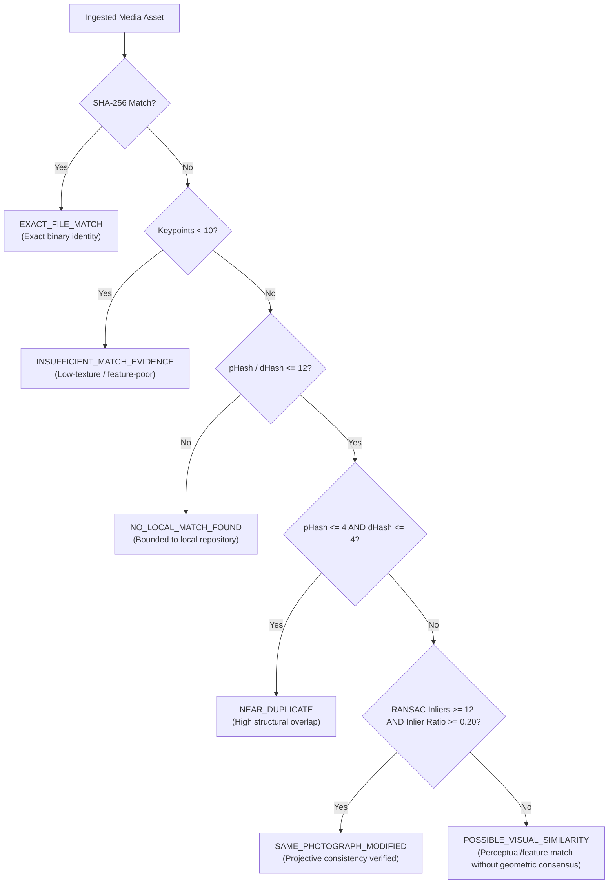

# Phase 3: Research & Technical Architecture (Revised)

## Technical Architecture & Methodology

### 1. Deterministic Image Preprocessing (`PREPROCESS-V1`)
To ensure hashes and feature descriptors are reproducible across platforms and formats:
- **EXIF Orientation:** Use Pillow `ImageOps.exif_transpose()` to ensure rotated phone uploads are normalized to upright orientation prior to hashing.
- **Color Conversion & Transparency:** Convert all images to RGB. If image has transparency (RGBA, LA, P with transparency), composite over solid white background `(255, 255, 255)` rather than allowing black-pixel alpha artifacts.
- **Animated Formats:** Extract first decodable frame (seek 0) for animated GIFs or WebPs.
- **Grayscale for Features:** Convert to 8-bit single-channel grayscale `cv2.cvtColor(..., cv2.COLOR_RGB2GRAY)` for ORB descriptor extraction.

### 2. Multi-Algorithm Candidate Generation
Perceptual hashes are candidate-generation methods only, never identity proof:
- `imagehash.phash(img)`: 64-bit DCT hash. Highly resilient to minor color grading, recompression, scaling.
- `imagehash.dhash(img)`: 64-bit gradient difference hash. Sensitive to structural horizontal/vertical edges.
- `imagehash.average_hash(img)`: 64-bit low-frequency average luminance hash.
- `imagehash.colorhash(img)`: HSV color histogram distribution.
- **Hamming Distance Search:**
  Distance is calculated via bitwise XOR popcount:
  $\text{dist}(h_1, h_2) = \text{popcount}(h_1 \oplus h_2)$.
  Candidate pre-filter threshold: $\min(\text{phash\_dist}, \text{dhash\_dist}) \le 12$.
  Latency and candidate count measured explicitly.

### 3. Local Feature Matching & RANSAC Homography Verification
ORB keypoint detection + RANSAC homography is supporting evidence, not an infallible arbiter:
- Keypoint Detector: `cv2.ORB_create(nfeatures=1000, scaleFactor=1.2, nlevels=8)`.
- Descriptor: 32-byte binary string per keypoint (shape `(N, 32)`, dtype `uint8`).
- Descriptor Storage & Security:
  Saved to internal storage under `data/derived/descriptors/{sha256[:2]}/{sha256}.npy`.
  Validated upon loading: check path safety, check file size $< 2\text{MB}$, `allow_pickle=False`, verify `ndim == 2`, `shape[1] == 32`, `dtype == np.uint8`.
- Matcher: `cv2.BFMatcher(cv2.NORM_HAMMING, crossCheck=False)`.
- Lowe's Ratio Test: Candidate match accepted if $d_1 < 0.75 \times d_2$.
- RANSAC Homography Estimation:
  `H, mask = cv2.findHomography(src_pts, dst_pts, cv2.RANSAC, 5.0)`
  - Inliers: $\text{count} = \sum \text{mask}$.
  - Inlier Ratio: $\text{count} / \text{len}(\text{good\_matches})$.
  - Recorded Metrics: `total_keypoints_query`, `total_keypoints_candidate`, `good_matches_count`, `inlier_count`, `inlier_ratio`, `transformation_matrix`, `failure_reason`.

### 4. Six Match Classifications Decision Logic

### 5. Cross-Investigation Privacy Architecture
- Fingerprints and descriptors reference `MediaAsset.id`.
- Match records are computed relative to `evidence_submissions.id`.
- Scoping rules:
  - `CURRENT_INVESTIGATION`: Source and match in same investigation. Full evidence context returned.
  - `GLOBAL_INDEX`: Match belongs to another investigation. Return `matched_media_asset_id`, match classification, raw metrics, occurrence count. Zero investigation titles, private notes, investigator names, or submission timestamps exposed.

### 6. Measurable Performance Telemetry
Every match run records:
- `fingerprints_examined`: Count of indexed assets compared.
- `candidates_retrieved`: Count passing Hamming filter.
- `retrieval_latency_ms`: Time taken for Hamming scan.
- `verification_latency_ms`: Time taken for ORB matching and RANSAC.
- `total_match_latency_ms`: End-to-end execution time.
