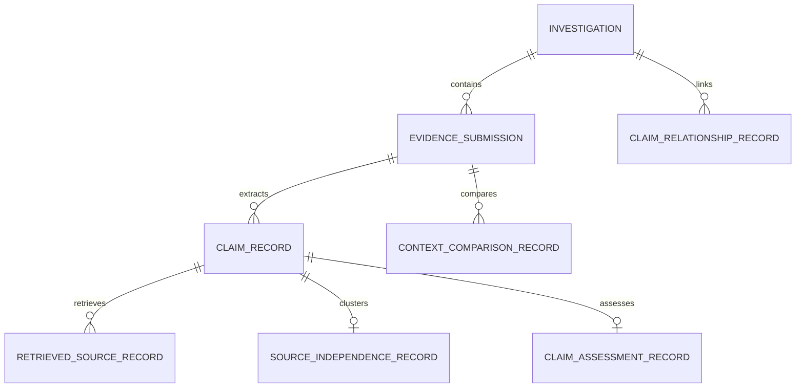

# Phase 4 Research & Architecture Specification

## 1. Technical Implementation Breakdown by Capability

| Capability | Category | Implementation Method | Fallback / Offline Behavior |
| :--- | :--- | :--- | :--- |
| **Claim Extraction** | Hybrid Algorithmic + NLP | Deterministic tokenization, entity/date/location chunkers, and atomic proposition decomposition into Subject-Predicate-Object (SPO) tuples with qualifiers. Extracts character offsets (`start_char`, `end_char`) to source text. Filters subjective opinions. | Bounded deterministic pattern extraction. Clearly distinguishes deterministic parsing from semantic model inference. Zero hallucination. |
| **Language Detection & Provenance** | Statistical NLP | N-gram frequency language detection (`langdetect`) evaluating statistical language models for English (`en`), Hindi (`hi`), and Telugu (`te`). Preserves detected language, detection method, and genuine detector confidence. | Falls back to Unicode script classification with `confidence=None` and method tagged `UNICODE_SCRIPT_FALLBACK`. No fabricated confidence. |
| **Contextual Verification Engine** | Mathematical / Spatial-Temporal | Evaluates date differences ($\Delta t$) and Haversine geodesic distances ($d$). Distinguishes `capture_date`, `publication_date`, `archive_date`, `submission_date`, and `truthnet_observation_date`. Treats EXIF as potentially editable and GPS as camera location. | Outputs `INSUFFICIENT_CONTEXT` if metadata is missing. Never concludes a claim is false solely due to older media or distant camera coordinates. |
| **Archival Reuse Classifier** | Contextual Signal Analysis | Analyzes caption framing keywords ("File photo", "Archive", "Retrospective", "Remembering 2018", "Flashback") alongside temporal alignment. Treats archival keywords as contextual signals rather than automatic guarantees. | Classifies as `POSSIBLE_CONTEXT_MISMATCH` or `LEGITIMATE_ARCHIVAL_REUSE` with explicit human review flags. |
| **Evidence Retrieval** | Multi-Provider Discovery | Queries: (1) Local curated ClaimReview JSON-LD archive, (2) Google Fact Check Tools API (when configured), (3) Web retrieval scraper with Phase 1 SSRF protections. Preserves passage snippets ($\le 500$ chars) and canonical URLs. | Returns honest availability status (`PROVIDER_UNAVAILABLE`, `OFFLINE`). Fully operational offline using local ClaimReview archive. Zero fabricated results. |
| **Source Independence Analyzer** | Multi-Signal Graph Analysis | Evaluates 4 independence dimensions: Publisher, Reporting, Evidence, and Source-of-Origin. Checks wire bylines ("PTI", "ANI", "Reuters", "AP"), canonical URLs, publication timestamps, shared quotes, text n-grams, and cited sources. | Marks ambiguous or incomplete metadata as `UNRESOLVED_DEPENDENCY`. Never counts syndicated reprints as independent corroboration. |
| **Claim Lineage Graph** | Graph Theory (NetworkX) | Directed multigraph linking `Investigation`, `EvidenceSubmission`, `MediaAsset`, `Claim`, `RetrievedSource`, and `Account`. Every edge is strictly tagged as `OBSERVED` or `INFERRED`, citing underlying evidence ID, method, and rationale. | Serialized as node-link JSON for graph visualization and tabular audit inspection. Prevents orphaned nodes. |
| **Explainable Evidence Assessment** | Deterministic Synthesis | Synthesizes independent corroboration, historical context signals, and fact-check stances into evidence assessments: `SUPPORTED`, `CONTRADICTED`, `MISLEADING_CONTEXT`, `INSUFFICIENT_EVIDENCE`, `CONFLICTING_EVIDENCE`, `UNVERIFIED`. Decouples media authenticity. | Abstains with `INSUFFICIENT_EVIDENCE` or `CONFLICTING_EVIDENCE` when data is missing or split. Compiles open questions for investigators. |

---

## 2. Mathematical & Algorithmic Formulations

### A. Geodesic Distance (Haversine Formula) & Spatial Limitations
For reference location $(\phi_1, \lambda_1)$ (e.g. claimed city or landmark) and observed EXIF GPS $(\phi_2, \lambda_2)$:
$$\Delta \phi = \phi_2 - \phi_1, \quad \Delta \lambda = \lambda_2 - \lambda_1$$
$$a = \sin^2\left(\frac{\Delta \phi}{2}\right) + \cos(\phi_1)\cos(\phi_2)\sin^2\left(\frac{\Delta \lambda}{2}\right)$$
$$d = 2 R \arctan2\left(\sqrt{a}, \sqrt{1 - a}\right) \quad (R = 6,371.0\text{ km})$$

**Spatial Epistemological Invariants:**
1. **Camera Location vs. Event Location**: GPS coordinates in image EXIF record where the camera was positioned when the sensor fired, not necessarily where the subject or event occurred (e.g. telephoto zoom, drone, or high-altitude photography).
2. **Centroid Approximation**: Named locations (e.g., "New Delhi", "Tehran") resolve to geographic centroids $(\phi_1, \lambda_1)$. Centroids are reference points, not forensic evidence. A distance $d > 50\text{ km}$ indicates spatial tension, not mathematical proof of fraud.
3. **Sensor Modifiability**: EXIF GPS data can be stripped, spoofed, or altered using standard software tools. EXIF coordinates are treated as unverified observational signals unless corroborated by visual landmark matching.

### B. Temporal Delta & Date Provenance Taxonomy
$$\Delta t_{\text{days}} = \frac{t_{\text{claimed}} - t_{\text{observed}}}{86,400\text{ seconds}}$$

**Date Taxonomy & Hierarchy:**
- `capture_date`: Timestamp recorded by camera hardware sensor (EXIF `DateTimeOriginal`). Subject to camera clock drift, timezone misconfigurations, or intentional tampering.
- `publication_date`: First known public dissemination timestamp (article publication date, social media post timestamp).
- `archive_date`: Snapshot timestamp from web archives (e.g., Wayback Machine, Google cache) or authoritative fact-checking databases.
- `submission_date`: Timestamp when the media/claim was submitted into TRUTHNET AI.
- `truthnet_observation_date`: Timestamp when TRUTHNET AI indexed the media asset and computed perceptual hashes.

**Temporal Conflict Rules:**
- If $t_{\text{claimed}}$ is after $t_{\text{observed}}$ by $> 30\text{ days}$ without archival framing keywords: Flags potential recycling signal (`HISTORICAL_CONTEXT_CONFLICT` or `POSSIBLE_CONTEXT_MISMATCH`).
- If $t_{\text{claimed}}$ is before $t_{\text{observed}}$ by $> 1\text{ day}$ (alleging an event happened before the photo was physically captured): Flags physical sequence impossibility.

### C. Multi-Signal Source Independence Matrix
Source independence cannot be determined by text similarity alone (e.g. two independent journalists might quote the same speech verbatim, while a syndicated wire dispatch might be lightly rewritten). TRUTHNET evaluates four orthogonal dimensions:

```
+-----------------------------------------------------------------------------------------+
|                               FOUR INDEPENDENCE DIMENSIONS                              |
+---------------------------+-------------------------------------------------------------+
| 1. Publisher Independence | Corporate separation, owner entity, distinct web domain     |
| 2. Reporting Independence | Independent byline, separate newsroom, distinct dispatch    |
| 3. Evidence Independence  | Distinct interviews, distinct FOIA docs, distinct footage   |
| 4. Origin Independence    | Separate primary witnesses vs citing one viral post         |
+---------------------------+-------------------------------------------------------------+
```

**Dependency Signals Evaluated:**
1. **Wire Agency Byline Match**: Detects syndication markers ("PTI", "Press Trust of India", "ANI", "Asian News International", "Reuters", "Associated Press", "AP", "AFP", "Bloomberg"). Articles sharing a wire marker are assigned to the same reporting cluster.
2. **Original Reporting Citations**: Parses attribution phrasing ("According to a report by [Publisher]", "First reported by [Outlet]", "Speaking to [Agency]"). Articles attributing reporting to an upstream outlet are chained to that source.
3. **Shared Quotation Overlap vs. Prose Overlap**: Distinguishes shared direct quotes (enclosed in quotation marks, common in press briefings) from identical narrative prose (indicative of syndicated copy-pasting).
4. **Publication Timestamp Precedence**: Identifies the primary outlet (earliest publication timestamp) vs derivative republications.
5. **Distinctive Phrasing N-Grams**: Computes 5-gram Jaccard overlap on non-quoted sentences. Overlap $> 0.50$ without citation indicates uncredited syndication or republishing.

**Graph Clustering & Uncertainty:**
- Sources form a directed dependency graph $G = (V, E)$ where edges represent republication or attribution relationships.
- The **Independent Source Count** $N_{\text{indep}}$ is the number of weakly connected source components.
- If publisher or attribution metadata is missing or contradictory, the relationship is labeled `UNRESOLVED_DEPENDENCY` and does NOT increment $N_{\text{indep}}$.
- Multiple republications of a single wire story are collapsed into a single `WIRE_REPUBLICATION_CHAIN` component ($N_{\text{indep}} = 1$).

---

## 3. Retrieval Providers & Concrete Specifications

### Provider 1: Local ClaimReview JSON-LD Archive
- **Role**: Primary offline verification archive and ground-truth repository.
- **Specification & Schema**: Schema.org `ClaimReview` JSON-LD specification. Each entry contains `claimReviewed`, `reviewRating` (`alternateName`, `ratingValue`), `itemReviewed` (`author`, `datePublished`, `appearance`), `author` (`name`, `url`), and `url`.
- **Dataset Provenance**: Curated baseline dataset of verified fact-checks from accredited IFCN signatories (e.g., BOOM Live, Vishvas News, Alt News, Factly, PIB Fact Check) covering historical disinformation claims in English, Hindi, and Telugu.
- **Storage**: Stored locally in `backend/app/retrieval/data/claimreview_archive.json` with indexed SQLite staging.
- **Update Strategy**: Versioned ingestion utility (`backend/scripts/ingest_claimreview.py`) that validates schema compliance, generates SHA-256 integrity hashes, and deduplicates records.
- **Licensing & Usage**: Open-access public fact-checking data published under Creative Commons / open public review terms.
- **Availability**: 100% offline availability; zero external network dependencies.

### Provider 2: Google Fact Check Tools API
- **Role**: Supplemental external retrieval provider for recent or global fact-checking publications.
- **API Endpoint**: `https://factchecktools.googleapis.com/v1alpha1/claims:search`
- **Authentication**: Google API Key supplied via environment variable `GOOGLE_FACTCHECK_API_KEY`.
- **Rate Limits & Quota**: Standard Google Cloud quota (10,000 requests/day, 60 requests/minute).
- **Data Coverage**: Aggregated global fact-checks marked up with ClaimReview.
- **Failure Handling**:
  - If `GOOGLE_FACTCHECK_API_KEY` is unset or blank: Service records `provider_status="UNCONFIGURED"`, logs an informative message, and seamlessly falls back to the local archive.
  - If network times out, connection fails, or HTTP 429/500 is received: Service records `provider_status="UNAVAILABLE"` or `"RATE_LIMITED"` and continues pipeline execution with local records.
  - **Zero Fabrication**: Under no circumstances does the adapter fabricate or simulate external fact-check responses.

### Provider 3: Web Retrieval & Passage Scraper
- **Role**: Discovery of primary source news articles and official government communiques.
- **Security & SSRF Hardening**: Inherits Phase 1 SSRF protections:
  - Blocks RFC 1918 private IPv4 ranges (`10.0.0.0/8`, `172.16.0.0/12`, `192.168.0.0/16`).
  - Blocks loopback addresses (`127.0.0.0/8`, `localhost`, `::1`).
  - Blocks link-local addresses (`169.254.0.0/16`, AWS/GCP cloud metadata endpoints).
  - DNS rebinding prevention via socket-level pre-resolution before connection.
  - Validates all HTTP redirects (maximum 3 redirects; each destination URL re-validated against the SSRF filter before following).
- **Passage Extraction**: Strips HTML tags, preserves exact supporting/contradicting excerpts with a strict cap of 500 characters, records character span offsets, and stores canonical URLs.

---

## 4. Database Schema Design (Additive & Non-Breaking)

All Phase 4 tables are additive and do not alter existing Phase 1–3 tables (`investigations`, `evidence_submissions`, `media_assets`, `derived_artifacts`, `extraction_records`, `media_fingerprints`, `media_match_records`).



### 1. `claims` table (`ClaimRecord`)
- `id`: String(36) (UUID, Primary Key)
- `investigation_id`: String(36) (Foreign Key -> `investigations.id` ON DELETE CASCADE, Indexed)
- `evidence_submission_id`: String(36) (Foreign Key -> `evidence_submissions.id` ON DELETE CASCADE, Indexed)
- `claim_text`: Text (Verbatim extracted assertion)
- `normalized_claim`: Text (Canonical predicate representation)
- `subject`: String(255) (Subject entity or concept)
- `predicate`: String(255) (Assertion verb / relation)
- `object`: Text (Object entity, quantity, or outcome)
- `qualifiers`: JSON (Temporal, spatial, and conditional qualifiers)
- `source_modality`: String(50) ("CAPTION", "RAW_TEXT", "OCR_EXTRACTED", "TRANSCRIPT")
- `evidence_span_start`: Integer (Character start offset in source text)
- `evidence_span_end`: Integer (Character end offset in source text)
- `source_text_hash`: String(64) (SHA-256 of originating text block)
- `extracted_entities`: JSON (Names, organizations, locations, dates, numbers)
- `language`: String(10) (Detected ISO 639-1 code: "en", "hi", "te", etc.)
- `language_detection_method`: String(50) ("langdetect_ngram", "unicode_script_fallback")
- `language_confidence`: Float (Nullable; populated ONLY when supplied by detector)
- `translation_provenance`: JSON (original_text, translated_text, engine, provenance)
- `is_factual_assertion`: Boolean (True if verifiable factual claim; False if opinion/rhetoric)
- `extraction_method`: String(50) ("HYBRID_NLP_PATTERN", "DETERMINISTIC_FALLBACK", "LLM_ASSISTED")
- `created_at`: DateTime(timezone=True)

### 2. `context_comparisons` table (`ContextComparisonRecord`)
- `id`: String(36) (UUID, Primary Key)
- `evidence_submission_id`: String(36) (Foreign Key -> `evidence_submissions.id` ON DELETE CASCADE, Indexed)
- `matched_media_asset_id`: String(36) (Foreign Key -> `media_assets.id` ON DELETE SET NULL, Nullable, Indexed)
- `match_record_id`: String(36) (Foreign Key -> `media_match_records.id` ON DELETE SET NULL, Nullable, Indexed)
- `classification`: String(50) (`HISTORICAL_CONTEXT_CONFLICT`, `POSSIBLE_CONTEXT_MISMATCH`, `CONSISTENT_CONTEXT`, `LEGITIMATE_ARCHIVAL_REUSE`, `INSUFFICIENT_CONTEXT`, `CONFLICTING_CONTEXT_EVIDENCE`)
- `claimed_event`: String(255)
- `claimed_date`: String(100)
- `claimed_date_type`: String(50) ("EVENT_DATE", "SUBMISSION_DATE", "UNKNOWN")
- `claimed_location`: String(255)
- `observed_date`: String(100)
- `observed_date_type`: String(50) ("CAPTURE_DATE", "PUBLICATION_DATE", "ARCHIVE_DATE", "TRUTHNET_OBSERVATION_DATE")
- `observed_date_source`: String(100) ("EXIF_DATETIME_ORIGINAL", "WAYBACK_FIRST_SEEN", "FACTCHECK_RECORD")
- `temporal_delta_days`: Float (Signed day difference; nullable)
- `observed_gps_lat`: Float (Nullable)
- `observed_gps_lon`: Float (Nullable)
- `reference_location_lat`: Float (Nullable)
- `reference_location_lon`: Float (Nullable)
- `spatial_distance_km`: Float (Nullable)
- `is_archival_reuse_signal`: Boolean (Default False)
- `comparison_metrics`: JSON (Detailed field-by-field diff and values origin)
- `reliability_limitations`: Text (Documents sensor caveats, editable EXIF, centroid approximations)
- `explanation`: Text (Transparent audit explanation)
- `requires_human_review`: Boolean (Default True)
- `created_at`: DateTime(timezone=True)

### 3. `retrieved_sources` table (`RetrievedSourceRecord`)
- `id`: String(36) (UUID, Primary Key)
- `claim_id`: String(36) (Foreign Key -> `claims.id` ON DELETE CASCADE, Indexed)
- `provider`: String(50) ("LOCAL_CLAIMREVIEW", "GOOGLE_FACTCHECK_API", "WEB_RETRIEVAL")
- `source_type`: String(50) ("FACT_CHECK_ARTICLE", "PRIMARY_NEWS_REPORT", "OFFICIAL_GOVERNMENT_COMMUNIQUE", "HISTORICAL_ARCHIVE")
- `publisher_name`: String(255)
- `publisher_domain`: String(255)
- `canonical_url`: String(1000)
- `article_title`: String(500)
- `published_date`: DateTime(timezone=True, Nullable)
- `fact_check_verdict`: String(100, Nullable)
- `passage_text`: Text (Preserved snippet $\le 500$ chars)
- `passage_span_start`: Integer (Nullable)
- `passage_span_end`: Integer (Nullable)
- `wire_attribution`: String(100, Nullable) ("PTI", "Reuters", "AP", "ANI", "AFP", "ORIGINAL_REPORTING", "UNSPECIFIED")
- `stance`: String(50) ("SUPPORTS", "CONTRADICTS", "MENTIONS", "NEUTRAL")
- `provider_status`: String(50) ("SUCCESS", "RATE_LIMITED", "OFFLINE_FALLBACK")
- `created_at`: DateTime(timezone=True)

### 4. `source_independence_clusters` table (`SourceIndependenceRecord`)
- `id`: String(36) (UUID, Primary Key)
- `claim_id`: String(36) (Foreign Key -> `claims.id` ON DELETE CASCADE, Unique, Indexed)
- `total_sources_count`: Integer
- `independent_sources_count`: Integer
- `publisher_independence_score`: Float
- `reporting_independence_score`: Float
- `evidence_independence_score`: Float
- `source_of_origin_independence_score`: Float
- `independence_assessment`: String(50) ("INDEPENDENT_CORROBORATION", "WIRE_REPUBLICATION_CHAIN", "SINGLE_SOURCE_ORIGIN", "UNRESOLVED_DEPENDENCY")
- `cluster_breakdown`: JSON (Detailed clustering dictionary with wire tags and shared quotes)
- `unresolved_reasons`: JSON (Explicit reasons when dependencies cannot be resolved)
- `explanation`: Text
- `created_at`: DateTime(timezone=True)

### 5. `claim_relationships` table (`ClaimRelationshipRecord`)
- `id`: String(36) (UUID, Primary Key)
- `investigation_id`: String(36) (Foreign Key -> `investigations.id` ON DELETE CASCADE, Indexed)
- `source_entity_id`: String(36) (Validated entity ID)
- `source_entity_type`: String(50) (Validated enum: `INVESTIGATION`, `SUBMISSION`, `MEDIA_ASSET`, `CLAIM`, `RETRIEVED_SOURCE`, `ACCOUNT`)
- `target_entity_id`: String(36) (Validated entity ID)
- `target_entity_type`: String(50) (Validated enum: `INVESTIGATION`, `SUBMISSION`, `MEDIA_ASSET`, `CLAIM`, `RETRIEVED_SOURCE`, `ACCOUNT`)
- `relationship_type`: String(50) (`SUPPORTS`, `CONTRADICTS`, `SAME_CLAIM`, `CLAIM_VARIANT`, `HISTORICAL_CONTEXT_CONFLICT`, `REPEATS_SOURCE`)
- `edge_nature`: String(50) (`OBSERVED`, `INFERRED`)
- `evidence_id`: String(36, Nullable) (Audit ID grounding this relationship)
- `confidence`: Float (Nullable; populated only when model provides calibrated score)
- `rationale`: Text (Explains why this relationship exists)
- `created_at`: DateTime(timezone=True)

### 6. `claim_assessments` table (`ClaimAssessmentRecord`)
- `id`: String(36) (UUID, Primary Key)
- `claim_id`: String(36) (Foreign Key -> `claims.id` ON DELETE CASCADE, Unique, Indexed)
- `assessment`: String(50) (`SUPPORTED`, `CONTRADICTED`, `MISLEADING_CONTEXT`, `INSUFFICIENT_EVIDENCE`, `CONFLICTING_EVIDENCE`, `UNVERIFIED`)
- `media_authenticity_signal`: String(50) (`AUTHENTIC`, `SUSPECTED_MANIPULATION`, `MANIPULATED_MEDIA_USED`, `INCONCLUSIVE`, `NOT_APPLICABLE`)
- `independent_sources_count`: Integer
- `supporting_sources_count`: Integer
- `contradicting_sources_count`: Integer
- `has_historical_context_conflict`: Boolean
- `context_classification`: String(50)
- `supporting_evidence_ids`: JSON (Array of evidence IDs supporting the claim)
- `contradicting_evidence_ids`: JSON (Array of evidence IDs contradicting the claim)
- `source_dependencies`: JSON (Summary of source clusters)
- `historical_context_findings`: JSON (Contextual verification summary)
- `unresolved_questions`: JSON (Array of structured open questions for investigators)
- `assessment_rationale`: Text (Synthesized human-readable explanation)
- `known_limitations`: Text (Limitations of retrieved data, OCR quality, or temporal gaps)
- `human_review_status`: String(50) (`PENDING_REVIEW`, `INVESTIGATOR_CONFIRMED`, `INVESTIGATOR_OVERRIDDEN`)
- `investigator_notes`: Text (Nullable)
- `created_at`: DateTime(timezone=True)
